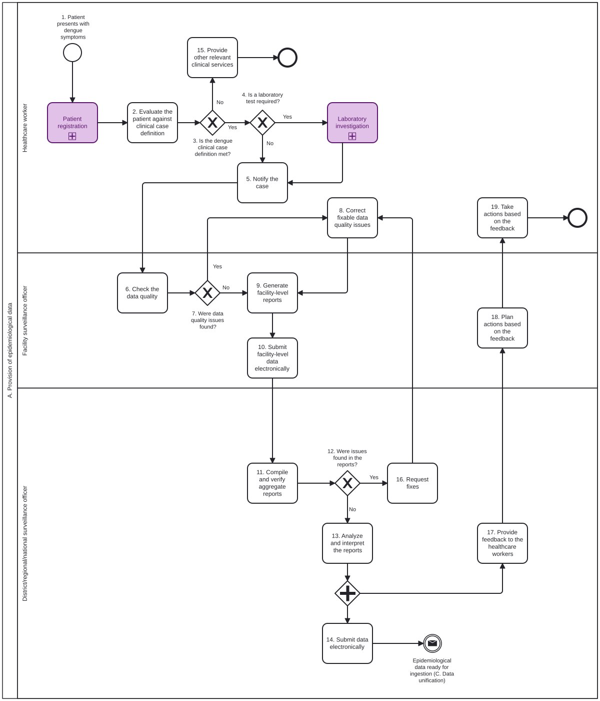
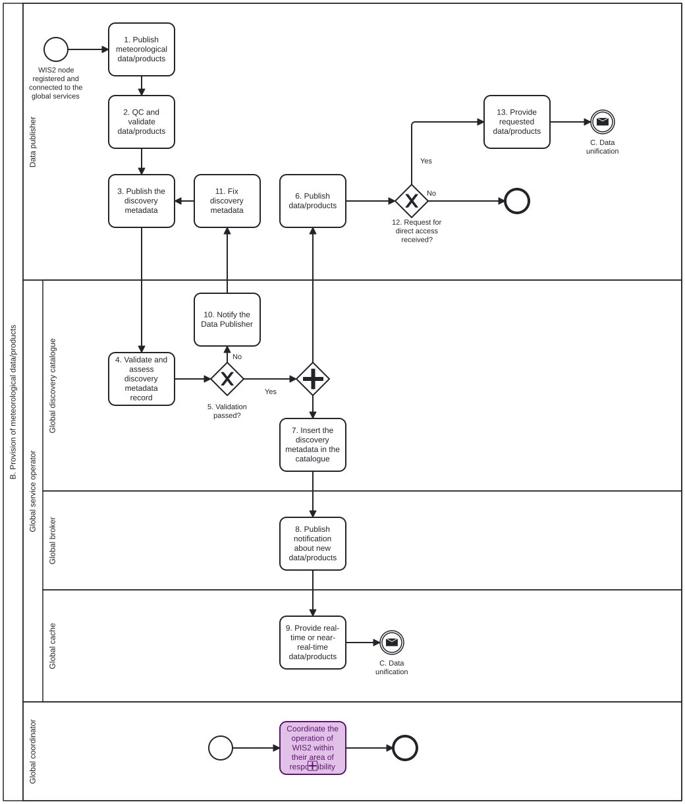
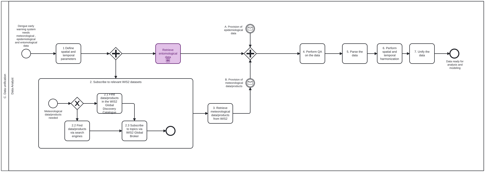

# Business Processes - SMART DAK CHUD v0.1.0

* [**Table of Contents**](toc.md)
* [**Business Requirements**](business-requirements.md)
* **Business Processes**

## Business Processes

A business process, or process, is a set of related activities or tasks performed together to achieve the objectives of the health programme area, such as registration, counselling, referrals. Workflows are a visual representation of the progression of activities (tasks, events, interactions) that are performed within the business process. The workflow provides a “story” for the business process being diagrammed and is used to enhance communication and collaboration among users, stakeholders and engineers. The workflows included in this DAK depict processes that have been generalized across different contexts and may not reflect the variability and nuances across different settings. The simplicity of the workflow may not adequately illustrate the nonlinear steps that may occur.

### Overview of Key Business Processes

The following table describes the workflows of the included processes.

| | | | | | |
| :--- | :--- | :--- | :--- | :--- | :--- |
|   | **Title** | **ID used to reference this process throughout the DAK** | **Individuals interacting to complete the process** | **A concrete statement describing what the process seeks to achieve** | **The general set of activities performed within the process** |
| **A** | Provision of epidemiological data | CHUD.A | Healthcare worker;Facility surveillance officer;District/regional/national surveillance officer | Routinely collect, aggregate, and curate epidemiological data as part of the surveillance process, ensuring the timely provision of high-quality inputs for predictive modelling of dengue outbreaks | Starting point: The patient presents with dengue disease symptoms.• Evaluate patient against clinical case definition• Notify case to surveillance team• Check data quality• Generate facility-level reports• Compile and verify aggregate reports• Analyse and interpret the reports• Submit data electronically |
| **B** | Provision of meteorological data/products | CHUD.B | Data publisher;Global service operator:• Global discovery catalogue• Global broker• Global cache | Collect meteorological observations and data necessary for dengue prediction models, curate the data and publish it on the WIS 2.0 network so that it can be retrieved by the data unification system, acting as a data consumer | Starting point: The data publisher collects meteorological observations, validate them and publish discovery metadata.• (Data publisher) Publish meteorological data/products• (Data publisher) QC and validate data/products• (Data publisher) Publish the discovery metadata• (Global service operator) Insert the discovery metadata in the catalogue• (Global service operator) Publish notification about new data• (Global service operator) Provide real-time or near-real-time data |
| **C** | Data unification | CHUD.C | Data unification system | To receive or retrieve epidemiological and environmental data, perform quality assurance on the data, harmonize and unify the data so that it becomes ready for analysis and modelling | Starting point: The data unification system gets epidemiological and environmental data.• Receive or retrieve epidemiological data• Retrieve meteorological data• Perform QA on the data• Parse the data and perform spatial and temporal harmonization• Unify the data |

-------

#### Process A: Provision of epidemiological data

**Objective:** Routinely collect, aggregate, and curate epidemiological data as part of the surveillance process, ensuring the timely provision of high-quality inputs for predictive modelling of dengue outbreaks.

 

**General note:** Epidemiological data provision encompasses both aggregate surveillance reporting (routine counts for trends) and detailed case-based reporting (richer demographic and risk factor data for model calibration and "detective work"). While treated as a single process here, the system must handle both data granularities.

**Business process notes and annotations:**

1. Patient presents with dengue symptoms
* The epidemiological data collection and provision business process is triggered on the health system side by events where health system patients present with dengue symptoms and request clinical services. The patient is registered in the health system prior to the start of the clinical encounter.
* **Note:** The "Patient registration" sub-process, coloured in purple, is not detailed in this first iteration of the business process.

1. Evaluate the patient against clinical case definition
* The healthcare worker performs an evaluation of the patient's symptoms against dengue clinical case definition, following the available clinical guidelines and guidance.
* **Guidelines:** [DENGUE Guidelines.pdf](https://www.who.int/publications/i/item/9789241547871)

1. Is the dengue clinical case definition met?
* The healthcare worker decides if the symptoms the patient presents meet the definition of a dengue case. In case the clinical case definition is not met, other relevant clinical services are offered (step 15).

1. Is a laboratory test required?
* The healthcare worker determines whether a laboratory test is required to confirm the suspected case, according to the national protocols.
* In dengue-endemic countries laboratory confirmation is not necessary before notification but should be obtained.
* **Guidelines:** [DENGUE Guidelines.pdf](https://worldhealthorg.sharepoint.com/:b:/r/sites/WMOWHODHICollaborationSpace/Shared%20Documents/General/Use%20Cases/Use%20Case%202%20-%20VBD/Dengue/DENGUE%20Guidelines.pdf?csf=1&web=1&e=rUmszf)
* 2.3.1 A stepwise approach to the management of dengue (see Table 2.2)

1. Notify the case
* The healthcare worker reports the case to the facility surveillance team. The reporting should be automated, based on the data collected during the clinical encounter, and should be performed electronically through the electronic surveillance system.
* At this point it is determined if the case is considered a suspected, probable or confirmed case
* Early notification of dengue cases seen in primary and secondary care is crucial for identifying outbreaks and initiating an early response
* "Passive surveillance" is the routine reporting of diseases, by which notification is usually initiated by health care providers. A particular challenge of passive surveillance systems is continuously to motivate health care providers to report cases in accordance with standardized case definitions. Unfortunately, in many dengue endemic countries, surveillance is only passive and relies on reports by local physicians who may not consider dengue in their differential diagnosis and/or fail to report cases quickly and routinely. As a result, an epidemic has often reached or passed its peak before it is recognized, and opportunities for control are missed. Designating dengue as a notifiable disease that is covered by public health legislation is one way to increase compliance with reporting
* This step represents the generation of case-based epidemiological data. It captures detailed patient demographics and risk factors required for immediate outbreak investigation and high-resolution model calibration
* **Guidelines:** [DENGUE Guidelines.pdf](https://worldhealthorg.sharepoint.com/:b:/r/sites/WMOWHODHICollaborationSpace/Shared%20Documents/General/Use%20Cases/Use%20Case%202%20-%20VBD/Dengue/DENGUE%20Guidelines.pdf?csf=1&web=1&e=rUmszf)
* 2.3.1 A stepwise approach to the management of dengue (see Table 2.2)

1. Check the data quality
* The data reported by the healthcare workers are reviewed for accuracy, validity and completeness.
* This can be supported through automated checks in a digital system.

1. Were data quality issues found?
1. Correct fixable data quality issues
* Where possible, inaccurate, invalid or incomplete data should be checked against source records and corrected according to the national standard operating procedures.
* Depending on local policy, this step might need to be delegated to a person with the appropriate data access rights.

1. Generate facility-level reports
* The facility surveillance officer generates reports containing facility level data.

1. Submit facility-level data electronically
* This can be automated and done digitally.
* Depending on the local policies and system design, an active "submission" may not be needed and the higher administrative levels (district, region, national authorities) should be able to access data directly in the system, for reporting purposes.

1. Compile and verify aggregate reports
* The surveillance officer, at a higher administrative level, generates aggregate reports of predefined indicators aligned with national dengue monitoring and evaluation guidelines.
* Once generated, the reports are checked for any potential remaining data quality issues such as implausible values or outputs.
* This can be automated and done digitally.

1. Were issues found in the reports?
* If so, the surveillance officer requests fixes for the issues (step 16). If no issues were identified, the flow continues with step 13 (Analyze and interpret the reports).

1. Analyze and interpret the reports
* The analyses and interpretation of the reports should identify opportunities to improve the performance of the health-care facility workers, such as tracing missing data or contacting patients who have not attended a clinic.
* Data analysis and interpretation can be done regularly and should not be limited to the reporting schedule.

1. Submit data electronically
* This can be automated and done digitally.
* Depending on the local policies and system design, an active "submission" may not be needed and the district-level, provincial-level and national-level ministry of health should be able to access data directly in the system, for reporting purposes.

1. Provide other relevant clinical services
* The health worker offers other relevant clinical and support services, including referrals, to the patient if dengue case definitions are not met. The services proposed are specific to each patient and clinical condition(s).

1. Request fixes
* In case the surveillance officer identifies issues in the reports, they request necessary fixes.
* If the source of issues is represented by data quality, the fixes will be addressed at data collection level (step 8. Correct fixable data quality issues).

1. Provide feedback to the healthcare workers
* The surveillance officer or the surveillance team at the facility, district or national level will provide feedback to the healthcare workers who reported the data. The purpose of feedback is to reinforce health workers' efforts at participating in the surveillance system. Another purpose is to raise awareness about certain diseases and any achievements made by disease-control and prevention projects in the area. Feedback is classified as supportive when it reinforces and acknowledges good performance, and corrective, when a change in behaviour and improvement is required.
* If data quality issues are identified, the facility may be required to restart the process and resubmit the data.
* **Guidelines and guidance:** Integrated disease surveillance response in the WHO African region. Booklet four: sections 8 and 9
* 8.5.2 Feedback

1. Plan actions based on the feedback
* The facility surveillance officer reviews the feedback and formulates a targeted action plan to address identified issues or reinforce positive practices.
* The plan may include corrective measures for data quality improvement, training needs, workflow adjustments, or reinforcement of successful practices.

1. Take actions based on the feedback
* Healthcare workers who submitted the data carry out the actions outlined in the action plan.
* Implementation should be guided by the surveillance officer and may involve collaboration with other staff, adherence to updated procedures, or participation in follow-up activities.

-------

#### Process B: Provision of meteorological data/products

**Objective:** Collect meteorological observations and data necessary for dengue prediction models, curate the data and publish it on the WIS 2.0 network so that it can be retrieved by the data unification system, acting as a data consumer.

 

**General note:**

The World Meteorological Organization (WMO) Information System (WIS) is the global system through which WMO Members exchange meteorological, hydrological, and climate data in real-time or near-real-time. It ensures interoperability through standardized formats and a unified data catalogue. WIS (including WIS 2.0) enables observations, forecasts, and warnings to circulate seamlessly and consistently worldwide.

| | |
| :--- | :--- |
| Real-time or near-real-time data is the range of data mandated for use with WIS2.0. Depending on the needs of the prediction model being used or developed and the data available through WIS2.0 in the specific context, this may require data storage by the model to achieve the desired data elements. Longer time ranges, such as historic data, may be accessible via WIS2.0; however, it is on a case-by-case basis. If historical data is required and not available via WIS2.0, this data should be sought from the nationally designated institutions or other authoritative data providers. Beyond the WMO climate and weather data exchange, international data centers such as [NCEI (Data Access | National Centers for Environmental Information)](https://www.ncei.noaa.gov/access/search/index) and[C3S (Climate Data Store)](https://cds.climate.copernicus.eu/), provide access to internationally exchanged data. If a denser spatial scale of the model or product is required – working directly with nationally designated institutions or other data providers for data access that is not real-time/near-real-time should be considered. |

**Guidelines and guidance:**

* Climate Data Management System Specifications. [WMO-No. 1131](https://library.wmo.int/idurl/4/51447)
* Manual on the WMO Information System, Volume II – WMO Information System 2.0. Annex VII to the WMO Technical Regulations. [WMO-No. 1060](https://library.wmo.int/idurl/4/68731)
* Guide to the WMO Information System, Volume II. WMO Information System 2.0. [WMO-No. 1061](https://library.wmo.int/idurl/4/69130)

**Business process notes and annotations:**

1. Publish meteorological data/products
* The Data Publisher publishes data and metadata to the Climate Data Management System (CDMS) to be stored, managed, and analysed. Data can include raw data or products.
* **Guideline:** Climate Data Management System Specifications. [WMO-No. 1131](https://library.wmo.int/idurl/4/51447)

1. Quality control (QC) and validate data/products
* These data and metadata are curated, using pre-defined quality control methods and curation/editing tools, to ensure that the data content and formats are as expected.

1. Publish the discovery metadata
* The Data Publisher publishes to its WIS node the discovery metadata that describes the data it makes available and how those data can be accessed. It will further publish a notification message to its Message broker, announcing the availability of new data.
* Discovery metadata must be published in the Global Discovery Catalogues before the data are published.
* **Guidelines:** Manual on the WMO Information System, Volume II – WMO Information System 2.0. Annex VII to the WMO Technical Regulations. [WMO-No. 1060](https://library.wmo.int/idurl/4/68731)
* Guide to the WMO Information System, Volume II. WMO Information System 2.0. [WMO-No. 1061](https://library.wmo.int/idurl/4/69130)

1. Validate and assess discovery metadata record
* The Global Discovery Catalogue will subscribe to notifications concerning the addition, updating, or deletion of discovery metadata records in the WIS centers.
* On receipt of a notification about new or updated discovery metadata, the Global Discovery Catalogue will download and validate a copy of the discovery metadata record, against the WMO Core Metadata Profile 2 (WCMP2), before inserting the record into the catalogue.
* Validation ensures compliance with the specification, while the assessment evaluates the discovery record against good practices.
* The Global Discovery Catalogue will periodically assess discovery metadata provided by Data Publishers [National Centers (NCs) and Data Collection or Production Centers (DCPCs)] against a set of key performance indicators (KPIs) in support of continuous improvement. Suggestions for improvement will be reported to the Global Monitor against the centre identifier associated with the discovery metadata record.
* **Guidelines:** Manual on the WMO Information System, Volume II – WMO Information System 2.0. Annex VII to the WMO Technical Regulations. [WMO-No. 1060](https://library.wmo.int/idurl/4/68731)
* Guide to the WMO Information System, Volume II. WMO Information System 2.0. [WMO-No. 1061](https://library.wmo.int/idurl/4/69130)

1. Validation passed?
1. Publish data/products
* The data is published on the WIS2 Node.
* The simplest way to publish data through WIS2 is to persist the data as files and publish those files on a web server.
* The Data publisher might also provide interactive access to data with APIs, enabling patient applications to request only the data they need.
* It is important to consider where the data are published. If the data relate to a specific country or territory, they should be published through a National Centre (NC). If they relate to a region, programme, or other specialized function within WMO, they should be published through a Data Collection or Production Centre (DCPC).
* **Guidelines:** Guide to the WMO Information System, Volume II. WMO Information System 2.0. [WMO-No. 1061](https://library.wmo.int/idurl/4/69130)

1. Insert the discovery metadata in the catalogue
* The Global Discovery Catalogue ingests and publishes the valid discovery metadata records provided by Data Publishers.
* The Global Discovery Catalogue may amend discovery metadata records to provide details on how to subscribe via Global Brokers to updates about the associated dataset.
* **Guidelines:** Manual on the WMO Information System, Volume II – WMO Information System 2.0. Annex VII to the WMO Technical Regulations. [WMO-No. 1060](https://library.wmo.int/idurl/4/68731)
* Guide to the WMO Information System, Volume II. WMO Information System 2.0. [WMO-No. 1061](https://library.wmo.int/idurl/4/69130)

1. Publish notification about new data/products
* The Global Broker republishes notifications from WIS nodes and Global Services, including notification messages advertising the availability of new data.
* **Guidelines:** Guide to the WMO Information System, Volume II. WMO Information System 2.0. [WMO-No. 1061](https://library.wmo.int/idurl/4/69130)

1. Provide real-time or near-real-time data/products
* The Global Cache provides a highly available data server, from which a data consumer can download core data. As per clause 3.2.13 of the Manual on WIS, Volume II, data consumers should access core data from the Global Caches.
* Upon receiving a notification message, the Global Cache downloads a copy of the data referenced in the message from the WIS2 Node, makes these data available on its server, and publishes a new notification message informing data consumers that they can now access these data on its server.
* The Global Cache will subscribe to notification messages from other Global Caches, enabling it to download and republish data that it has not acquired directly from WIS2 Nodes. This ensures that each Global Cache holds data from every WIS2 Node.
* **Guidelines:** Guide to the WMO Information System, Volume II. WMO Information System 2.0. [WMO-No. 1061](https://library.wmo.int/idurl/4/69130)
* Manual on the WMO Information System, Volume II – WMO Information System 2.0. Annex VII to the WMO Technical Regulations. [WMO-No. 1060](https://library.wmo.int/idurl/4/68731)

1. Notify the Data Publisher
* The Global Discovery Catalogue will notify the data publisher if the discovery metadata record fails validation and provide recommendations for improvements.
* **Guidelines:** Guide to the WMO Information System, Volume II. WMO Information System 2.0. [WMO-No. 1061](https://library.wmo.int/idurl/4/69130)

1. Fix discovery metadata
* The Data Publisher fixes the issues and re-publishes the discovery metadata record.

1. Request for direct access received?
1. Provide requested data/products
* A WIS node may restrict access to its core data, relying on Global Caches to provide access to data consumers.
* Recommended data are never cached by the Global Caches, and may be provided by data publisher with conditions on use. This means that the data publisher may control access to recommended data.
* If controlled access to the data has been implemented (for example, through the use of an API key), the download link should include a security object which provides the pertinent information (the access control mechanism used, where or how a data consumer needs to register to request access, and so forth).
* Data publishers must ensure that core data that are not cached (republished on Global Cache) are publicly accessible from their WIS2 Node, that is, with no access control mechanisms in place.
* **Guidelines:** Guide to the WMO Information System, Volume II. WMO Information System 2.0. [WMO-No. 1061](https://library.wmo.int/idurl/4/69130)

-------

#### Process C: Data unification

**Objective:** To receive or retrieve epidemiological and environmental data, perform quality assurance on the data, harmonize and unify the data so that it becomes ready for analysis and modelling.

 

**Business process notes and annotations:**

1. Define spatial and temporal parameters
* For epidemiological and entomological data, the type of data (real-time, historical, aggregate, case-based) required for model execution should be determined based on the model's specifications. This may influence the retrieval process and access methods. Please refer to model documentation for specific requirements.
* For climate and weather data, the type of data required will depend on dengue prediction model being used or developed. To identify the appropriate data, the region/location, the spatial resolution (e.g. 25 km), the type and range (e.g. forecast range, hindcast range, reanalysis), and the update frequency (e.g. weekly) must be specified. These specifications enable the data analyst to understand which sources of data are required.
* The epidemiological and entomological data and climate and weather data should match in spatial and temporal parameters for unification.

1. Subscribe to relevant WIS2 datasets
* **2.1 Find data/products in the WIS2 Global Discovery Catalogue:** The first step to using data published via WIS2 is to determine which dataset or datasets contain the data that are needed. To do this, a data consumer, in our case the data unification system, may browse discovery metadata provided by the Global Discovery Catalogue.
* A data consumer may discover a dataset using keywords, a geographic area of interest, temporal information, or free text. Matching search results from the Global Discovery Catalogue provide high-level information (title, description, keywords, spatiotemporal extents, data policy, licensing, contact information), from which data consumers can assess and evaluate their interest in accessing/downloading data associated with the dataset record.
* **2.2 Find data/products via search engines:** Internet search engines are able to index the discovery metadata in the Global Discovery Catalogue, thereby providing data consumers with an alternative means to search for WIS2 data.
* **2.3 Subscribe to topics via WIS2 Global Broker:** Data consumers requiring real-time notifications must subscribe to Global Brokers. Data consumers should subscribe to more than one Global Broker to ensure that notifications continue to be received if a Global Broker instance fails.
* Data consumers should subscribe to notifications from a Global Broker, not to notifications directly from the Message Brokers operated by WIS2 Nodes.
* WIS2 provides notifications about updates to datasets, for example, when a new observation record from an automatic weather station is added to a dataset of surface observations. These notifications are published on Message Brokers. Where data consumers need to use data rapidly once they have been published (for example, as inputs to a weather prediction model), they should subscribe to one or more Global Brokers to get notification messages using Message Queuing Telemetry Transport (MQTT) protocol.
* **Guidelines:** Guide to the WMO Information System, Volume II. WMO Information System 2.0. [WMO-No. 1061](https://library.wmo.int/idurl/4/69130)

1. Retrieve meteorological data/products from WIS2
* On receipt of a notification message, a data consumer needs to decide whether to download the newly available data. The content of the notification message provides the information needed to make this decision (see the Manual on WIS, Volume II – Appendix E. WIS2 Notification Message).
* Once decided, the data unification system, playing the data consumer role, retrieves the meteorological data from:
* **Global Cache:** The Global Caches are designed to help Members efficiently share real-time and near-real-time data. They ensure that core data are available to all on a free and unrestricted basis, as required by the WMO Unified Data Policy (Resolution 1 (Cg-Ext(2021))).
* **WIS2 Node:** If frequent updates to a dataset are very large (for example, in the case of weather prediction models or remote sensing observations) data publishers will need to share the burden of distributing their data with Global Cache operators. Therefore, the data consumer might need to access the data directly from the Data publisher's WIS2 Node (with no access control mechanisms in place).
* Recommended data, opposed to Core data, are not cached within WIS2 by the Global Caches, therefore are accessible directly on the WIS2 Node. Recommended data may be provided with conditions on use and/or subject to a license and may have access controls applied at the WIS2 Node.
* Data archives are also usually accessed directly via the WIS2 Node, given that Global Caches provide only short-term data hosting (for instance, for 24 hours).
* **Guidelines:** Guide to the WMO Information System, Volume II. WMO Information System 2.0. [WMO-No. 1061](https://library.wmo.int/idurl/4/69130)
* Annex 1 of Resolution 1 (Cg Ext (2021)), the WMO Unified Policy for the International Exchange of Earth System Data, lists the core and recommended data to be exchanged for the following Earth system domains: weather, climate, hydrology, atmospheric composition, cryosphere, oceans, and space weather. [WMO-No. 1281](https://library.wmo.int/records/item/57850-world-meteorological-congress)
* Manual on the WMO Information System, Volume II – WMO Information System 2.0. Annex VII to the WMO Technical Regulations. [WMO-No. 1060](https://library.wmo.int/idurl/4/68731)

1. Perform QA on the data
* The epidemiological and climate data retrieved by the data unification system undergoes quality control verifications. This might imply checking for data completeness, consistency and accuracy but also validating the data against data standards (FHIR for EPI data, WIS 2.0 for climate data).
* The approach to data quality assurance will vary, with well-resourced nations increasingly leveraging automated processes for real-time consistency checks, while countries with emerging data systems may still rely on essential manual verification and communication with data providers to address complicated errors.

1. Parse the data
* The system parses the epidemiological and climate data/products retrieved from different sources to ensure the data is in the expected format.

1. Perform spatial and temporal harmonization
* This process acts as the bridge between the disparate data sources, aligning meteorological data (often gridded or point-based) and epidemiological data (aggregated by administrative boundaries) into a consistent framework; this is executed by a data analyst and/or the system depending on the infrastructure available (ranging from manual approaches to fully automated pipelines).
* The data analyst and/or system performs temporal harmonization by converting high-frequency climate data (e.g., daily or hourly readings) into standard 7-day epidemiological weeks to match the health reporting cadence, applying configurable aggregation logic (e.g., mean, min, max) to accurately represent that week's conditions.
* Spatial harmonization is achieved by mapping and aggregating data to the target administrative level (e.g., District), which involves handling resolution mismatches through techniques like downscaling coarse global forecast models (e.g., from 30 km to 2 km) or aggregating gridded data to fit district polygons.
* To ensure robust modeling inputs, the workflow accounts for data discrepancies and uncertainties ensuring that the unified dataset compares "like with like".

1. Unify the data
* The system automatically unifies the two separate data streams (epidemiological and climate) into a unified repository making the data ready to be used in the prediction model(s).

-------

### Additional considerations for adapting workflows

These workflows are meant to be generic and high-level. A degree of customization and adaptation will be needed as they are translated into a digital system for a specific context. The workflows are considered to be 80% complete – the other 20% will need to be done through a series of person-centered design methods and mechanisms to complete the workflows for implementation. For example, the approach to data quality assurance will need to be adapted to local capacities; while well-resourced nations may leverage automated processes for real-time consistency checks, countries with emerging data systems may still rely on essential manual verification and communication with data providers to address errors. Similarly, the level of automation in data unification will depend on the available infrastructure, ranging from fully automated pipelines to manual execution by a data analyst.

Furthermore, local policies and system design will dictate specific workflow steps, such as whether facility-level data requires an active "submission" or if higher administrative levels (district, regional, national) can access data directly within the system. Finally, the specific predictive model selected for implementation will influence the retrieval process, determining whether real-time, historical, aggregate, or case-based data is required.

